# Experiment 2 — Priority and Round Robin Scheduling

**Date:** 30-07-2026  
**Roll No.:** 25071A6263

## Aim

Write C programs for Priority scheduling (Non-preemptive and Preemptive) and Round Robin scheduling with Time Quantum = 2 and Time Quantum = 10.

## Source Files

- [`priority_non_preemptive.c`](src/priority_non_preemptive.c)
- [`priority_preemptive.c`](src/priority_preemptive.c)
- [`round_robin_tq2.c`](src/round_robin_tq2.c)
- [`round_robin_tq10.c`](src/round_robin_tq10.c)

## Output Snippets

### Priority Non-Preemptive
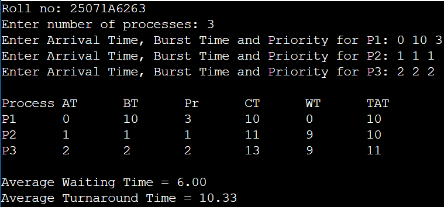
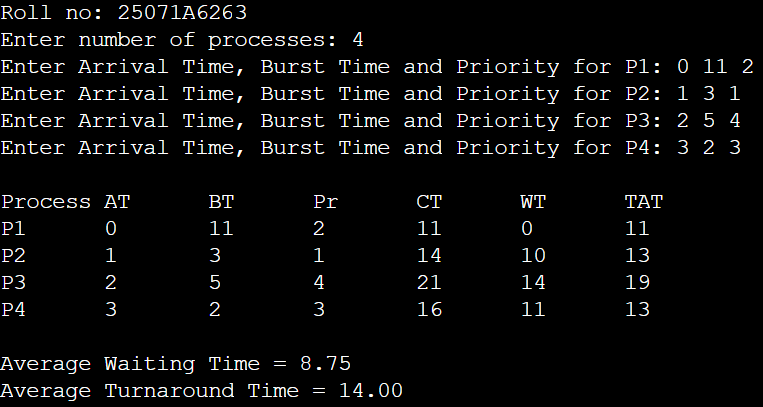
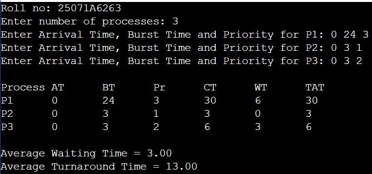

### Priority Preemptive
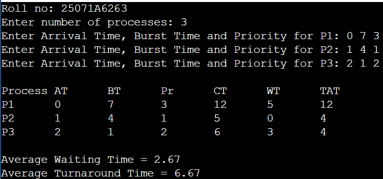
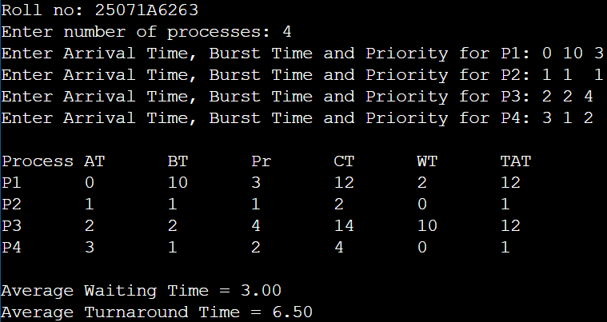
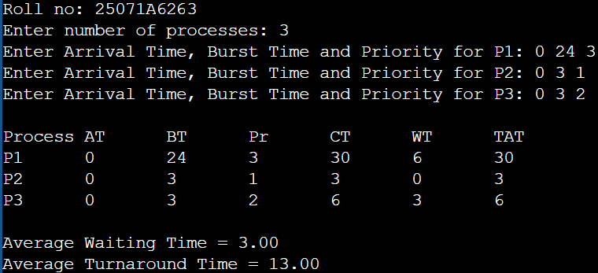

### Round Robin TQ = 2
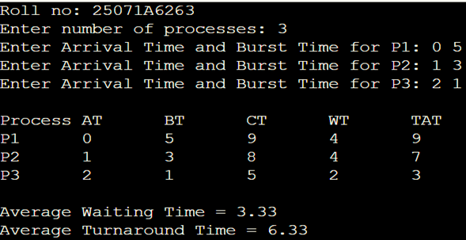
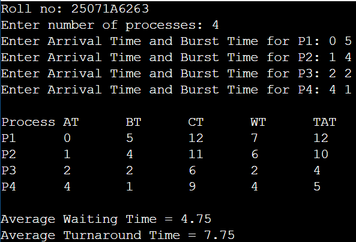
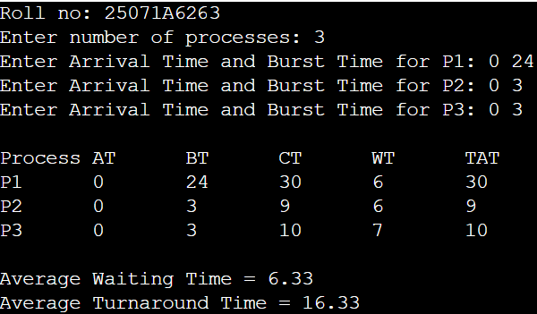

### Round Robin TQ = 10
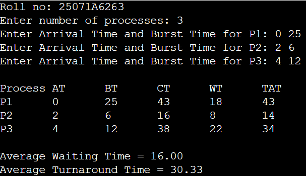
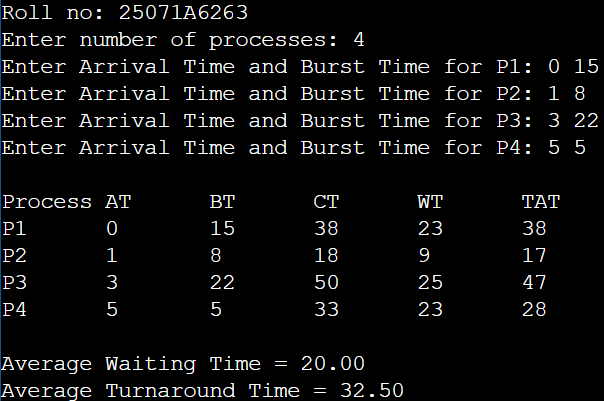
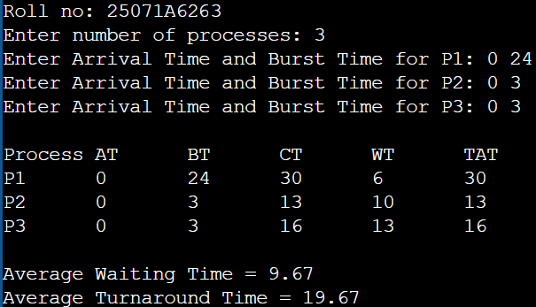
