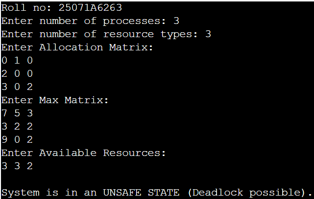
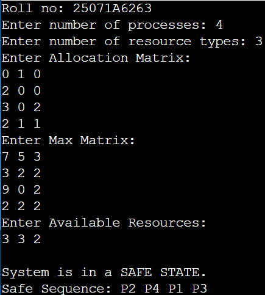
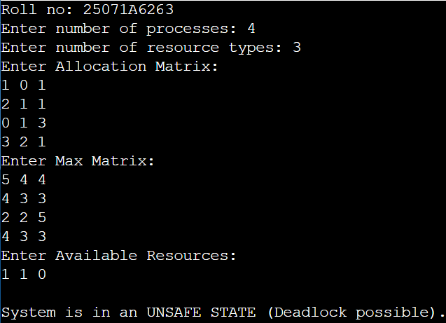
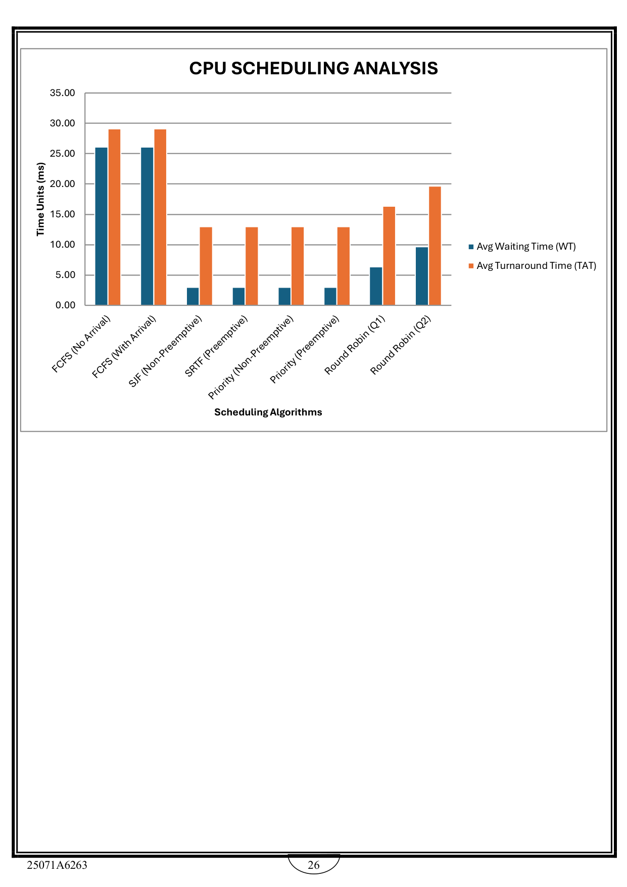

# Experiment 3 — Banker’s Algorithm and Scheduling Analysis

  
**Roll No.:** 25071A6263

## Aim

Make the analysis of all scheduling algorithms and simulate Banker's algorithm for deadlock avoidance.

## Source Files

- [`bankers_algorithm.c`](src/bankers_algorithm.c)

## Output Snippets

### Banker's Algorithm

### CPU Scheduling Analysis Chart

