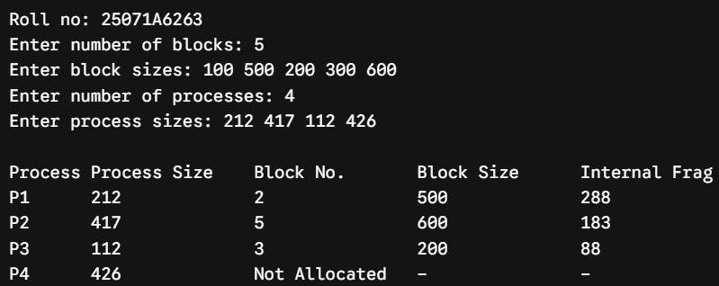
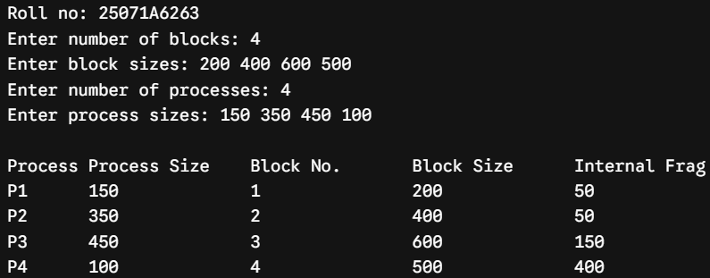
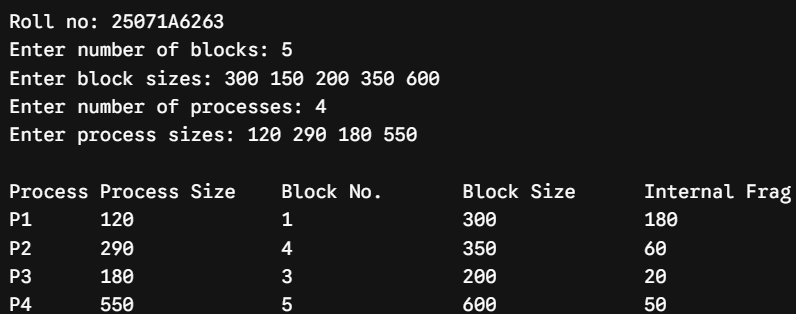
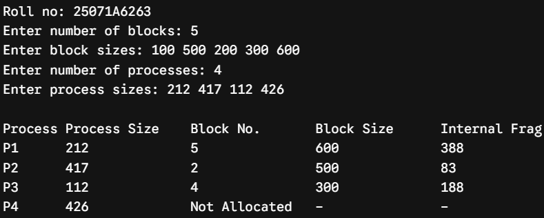
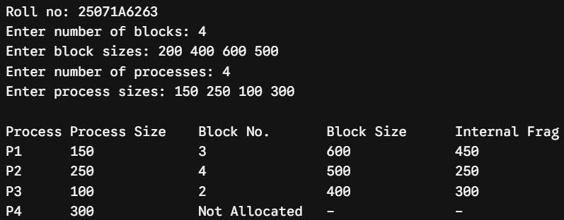
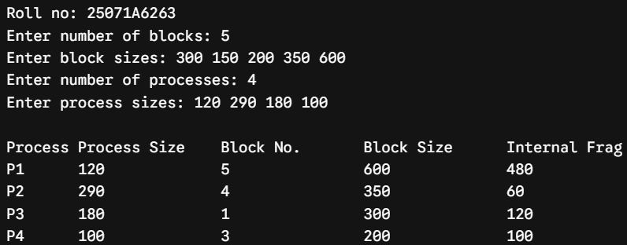
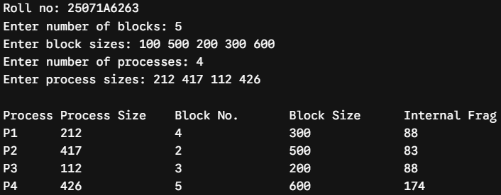
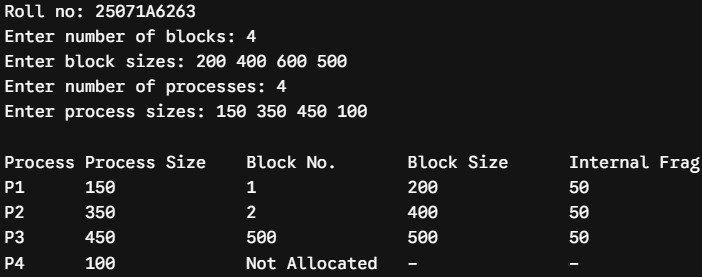
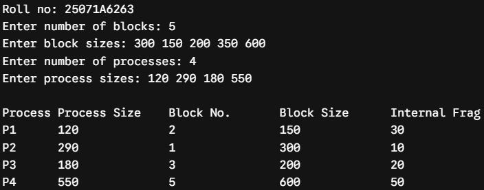

# Experiment 4 — Fixed-Partition Memory Allocation

**Date:** 27-08-2026  
**Roll No.:** 25071A6263

## Aim

Implementation of Memory Allocation Methods for fixed partition: a) First Fit b) Worst Fit c) Best Fit.

## Source Files

- [`first_fit.c`](src/first_fit.c)
- [`worst_fit.c`](src/worst_fit.c)
- [`best_fit.c`](src/best_fit.c)

## Output Snippets

### First Fit

### Worst Fit

### Best Fit

