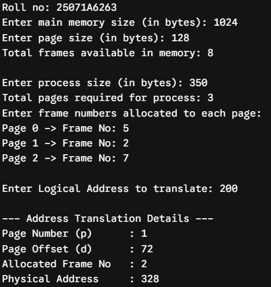
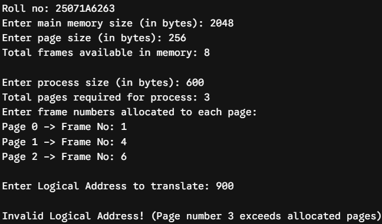
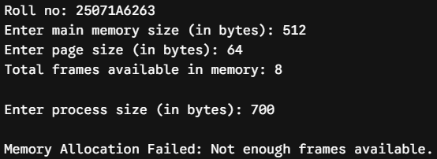

# Experiment 5 — Paging Technique of Memory Management

**Roll No.:** 25071A6263

## Aim

Implementation of Paging Technique of Memory Management and logical to physical address translation.

## Source Files

- [`paging_address_translation.c`](src/paging_address_translation.c)

## Output Snippets

### Paging Address Translation

