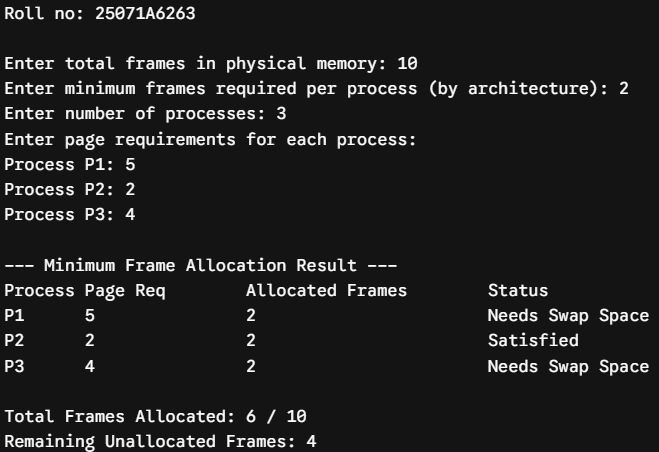
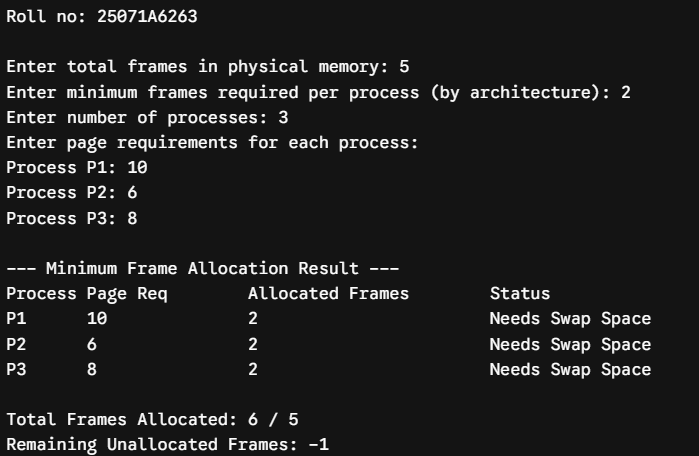
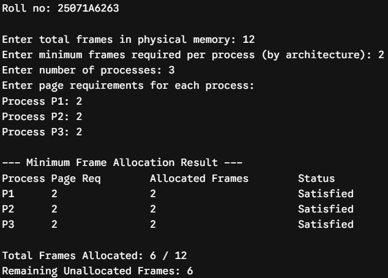
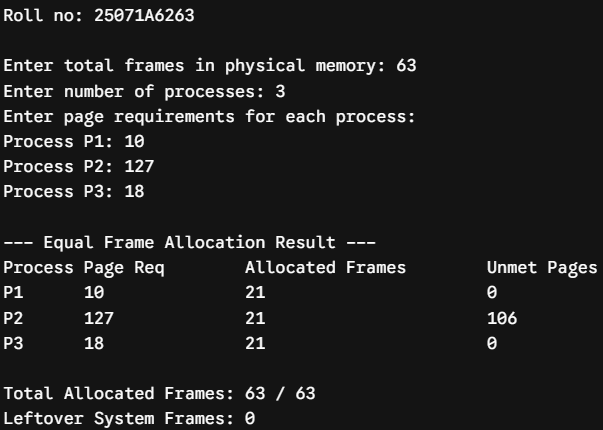
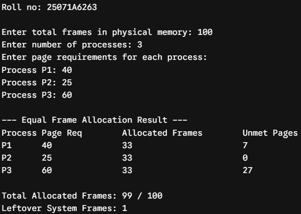
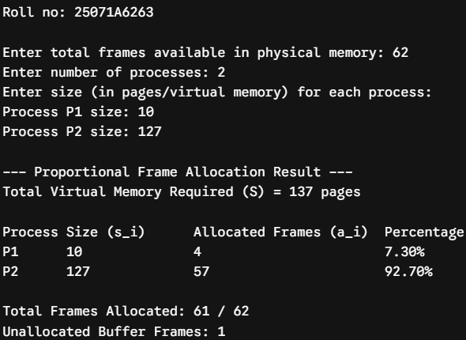
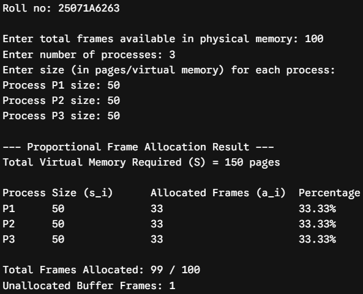
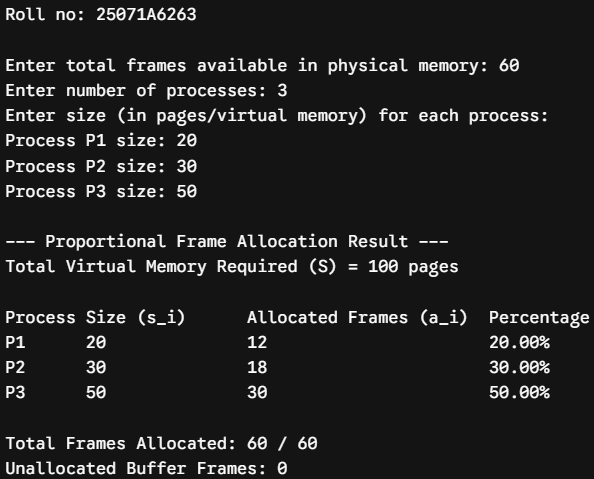

# Experiment 7 — Frame Allocation Methods

**Roll No.:** 25071A6263

## Aim

Simulate frame allocation Methods: A) Minimum number of frames B) Equal allocation C) Proportional allocation.

## Source Files

- [`minimum_frame_allocation.c`](src/minimum_frame_allocation.c)
- [`equal_frame_allocation.c`](src/equal_frame_allocation.c)
- [`proportional_frame_allocation.c`](src/proportional_frame_allocation.c)

## Output Snippets

### Minimum Number of Frames

### Equal Allocation

### Proportional Allocation

