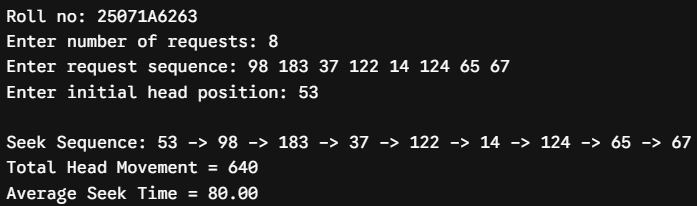
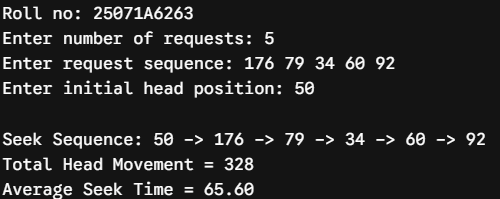
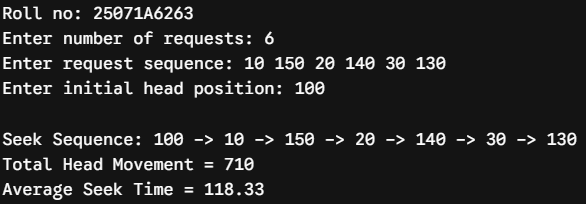
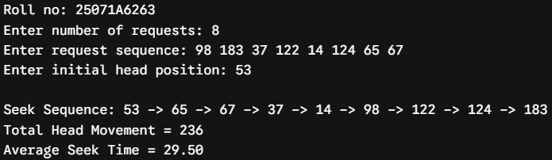
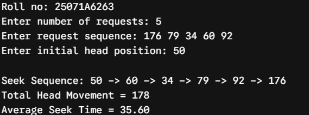
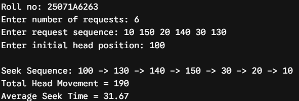
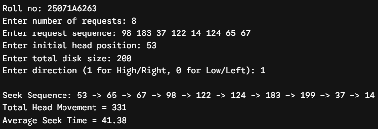
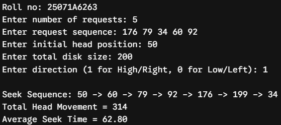
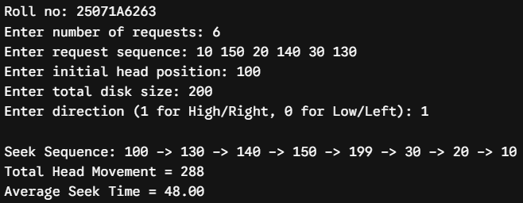

# Experiment 8 — Disk Scheduling: FCFS, SSTF and SCAN

**Date:** 10-09-2026  
**Roll No.:** 25071A6263

## Aim

Simulate the following Disk scheduling algorithms: A) FCFS B) SSTF C) SCAN.

## Source Files

- [`disk_fcfs.c`](src/disk_fcfs.c)
- [`disk_sstf.c`](src/disk_sstf.c)
- [`disk_scan.c`](src/disk_scan.c)

## Output Snippets

### FCFS

### SSTF

### SCAN

