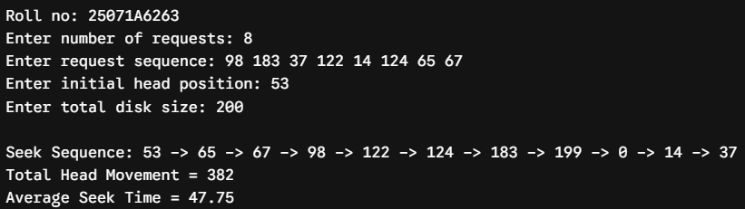
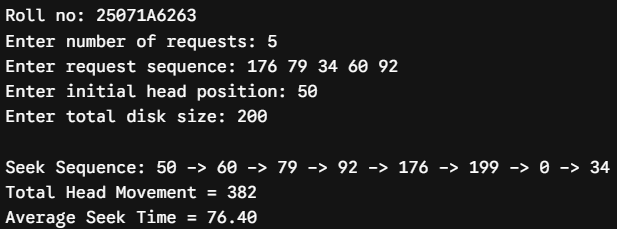
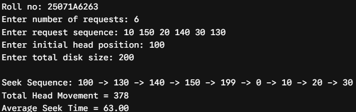
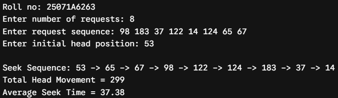
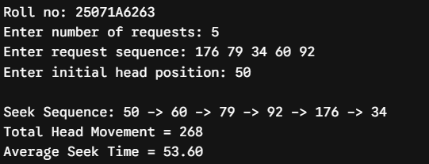
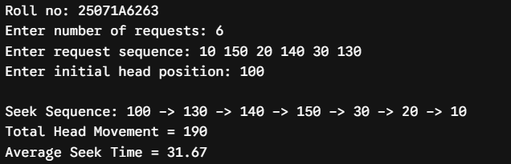
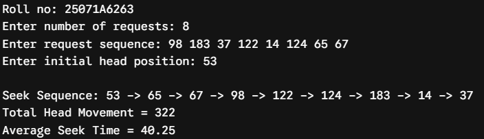
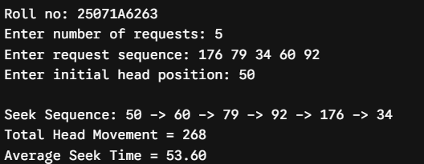
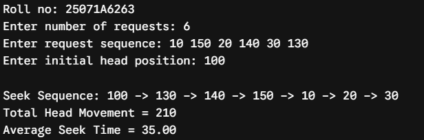

# Experiment 9 — Disk Scheduling: C-SCAN, LOOK and C-LOOK

**Date:** 17-09-2026  
**Roll No.:** 25071A6263

## Aim

Simulate the following Disk scheduling algorithms: A) C-SCAN B) LOOK C) C-LOOK.

## Source Files

- [`disk_cscan.c`](src/disk_cscan.c)
- [`disk_look.c`](src/disk_look.c)
- [`disk_clook.c`](src/disk_clook.c)

## Output Snippets

### C-SCAN

### LOOK

### C-LOOK

