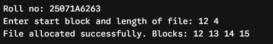
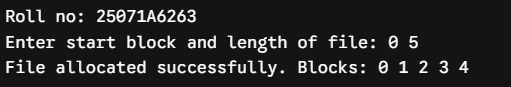
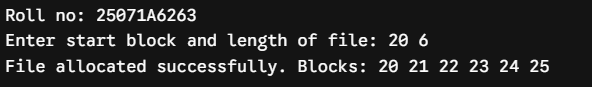
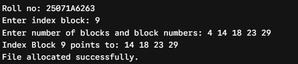
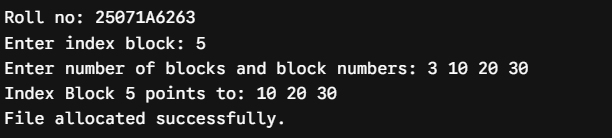
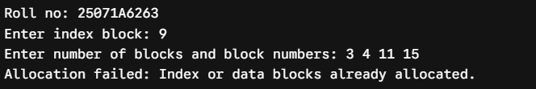
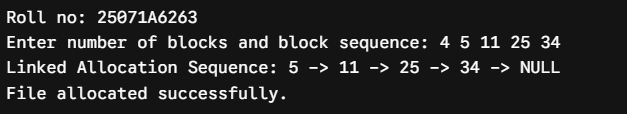
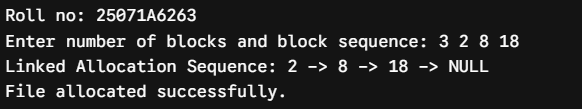
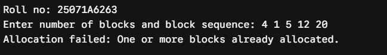

# Experiment 10 — File Allocation Strategies

**Roll No.:** 25071A6263

## Aim

Simulate all file allocation strategies: A. Sequential, B. Indexed, C. Linked.

## Source Files

- [`file_sequential.c`](src/file_sequential.c)
- [`file_indexed.c`](src/file_indexed.c)
- [`file_linked.c`](src/file_linked.c)

## Output Snippets

### Sequential File Allocation

### Indexed File Allocation

### Linked File Allocation

